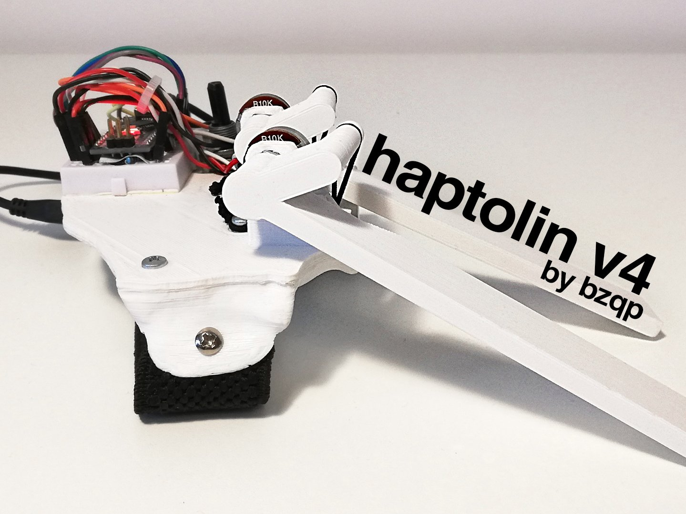
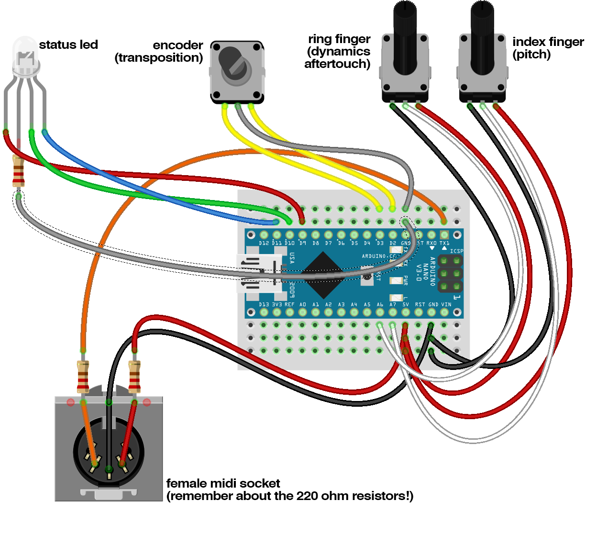

# Haptolin

My microtonal Arduino MIDI instrument!

_Originally published on 28 February 2020._

Haptolin is an Arduino-based, microtonal instrument / MIDI controller. The project is mainly inspired by:

- Theremin
- Modulin
- HaptX Glove
- Power Glove

Haptolin produces a theremin-like sound while providing analog haptic feedback, which allows precise pitch control. Whereas the HaptX glove relies on a complex, actuator-based feedback system, Haptolin uses simple braided elastic bands. The higher the pitch, the stronger the response. The left key controls the pitch, the right one controls the dynamics.

Unlike most microtonal MIDI instruments, Haptolin uses native MIDI and implements microtonality through pitch shifts in between the notes. Thanks to this, Haptolin works with most MIDI synthesizers without any drivers.

## Videos

- [Haptolin](https://youtu.be/PjdyenC6T5A)
- [Haptolin cover of Wintergatan's "All Was Well"](https://youtu.be/8C2lT8tFt8I)

## Repository contents

| Path | Contents |
|---|---|
| [`haptolin/haptolin.ino`](haptolin/haptolin.ino) | Arduino code |
| [`stl/`](stl) | 3D printing files (upper half, lower half, keys) |
| [`images/wiring.png`](images/wiring.png) | Wiring diagram |
| [`images/`](images) | Photos |

## Parts

- Arduino Nano (genuine or compatible)
- Mini breadboard
- EC11 rotary encoder module
- 2× rotary potentiometer (10 kΩ)
- RGB LED, common cathode
- 3× 220 Ω resistor
- 4-pin female header (optional, for the LED)
- Female MIDI socket
- MIDI cable
- USB-A to Mini-USB cable
- Generic, cylindrical power bank (~21 mm in diameter)
- Braided elastic bands (don't use normal bands, they wear out in minutes; the braided ones last for months)
- Elastic strap, 30 mm wide
- M3 bolts and nuts (various lengths)
- Jumper wires

## Wiring

| Arduino pin | Connected to |
|---|---|
| A7 | Pitch potentiometer |
| A6 | Dynamics potentiometer |
| D2, D3 | Rotary encoder (transposition) |
| D9, D10, D11 | RGB LED (red, green, blue) |
| TX | MIDI out (31250 baud) |

## How it works

- The pitch key selects a MIDI note and a pitch bend value, so the pitch changes continuously between the notes.
- The dynamics key sends MIDI Control Change 14 (dynamics) and, when pressed further, Control Change 15.
- The rotary encoder transposes the instrument up or down by a semitone.
- The RGB LED shows the current pitch and dynamics.

The pitch bend between notes is calculated for a pitch bend range of ±2 semitones, which is the default on most synthesizers.

## 3D printing

The Haptolin was photogrammetrically fitted to my hand, so your experience may vary depending on your palm size.

- Printer: Prusa i3 clone
- Material: PLA
- Infill: 20%
- Supports: not needed, they are included in the files. Remove them after printing (next to the elastic band mounts).
- Rafts: no

The longer key is for the dynamics control (ring finger). The shorter one is for the pitch (index finger).

## Assembly

Slide the potentiometers into the holes and fix them in place with a nut. The elastic bands are hooked on one side to the key attachments, and on the other side to the M3 bolts that hold the two halves of the case together.

The belt is a 30 mm wide elastic strap. On one side (next to the power bank) glue it to the case. On the other side it is held with an M3 nut, which makes it adjustable. You only need to adjust it once; when the strap is mounted properly you can just slide your palm in.

## Links

- [Arduino Project Hub](https://projecthub.arduino.cc/bzqp/haptolin-9d0544)
- [Thingiverse](https://www.thingiverse.com/thing:4190495)

## License

Haptolin by bzqp is licensed under the [Creative Commons Attribution 4.0 International](https://creativecommons.org/licenses/by/4.0/) license (CC BY 4.0). See [LICENSE](LICENSE).
